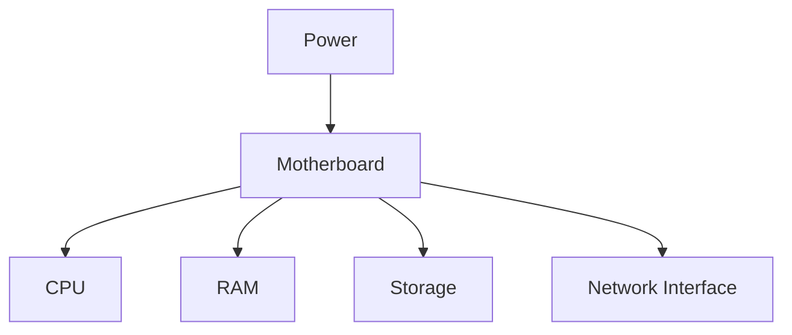

# Computer Hardware Fundamentals

## Introduction
Computer hardware is the physical equipment that runs an operating system and applications. A server is a computer designed to provide resources or services to other systems.

## Definition
Hardware includes the physical components of a computer, such as the CPU, memory, storage devices, network interfaces, motherboard, and power supply.

## How It Works
1. The power supply provides electricity. 2. Firmware initializes hardware. 3. The CPU executes instructions. 4. RAM holds active code and data. 5. Storage keeps files when power is off. 6. The network interface sends and receives data.

## Important Components
- **CPU:** Executes instructions and calculations.
- **RAM:** Temporarily holds active programs and data.
- **Storage:** Persists the OS, applications, and files.
- **NIC:** Connects a machine to a network.
- **Motherboard:** Connects the system components.

## Real-World Example
A cloud VM exposes virtual CPU, memory, disk, and network resources. If a website slows down, an engineer checks these resources before assuming the application code is the only cause.

## Why DevOps Engineers Need This
Capacity planning and incident response require understanding whether CPU, memory, storage, or network resources are constrained.

## Diagram


## Linux Commands and Examples
### `lscpu`
Show CPU architecture and CPU count.

```bash
lscpu
```

### `free -h`
Show memory and swap in readable units.

```bash
free -h
```

### `lsblk`
List block devices.

```bash
lsblk
```

### `df -h`
Show mounted filesystem usage.

```bash
df -h
```

### `ip addr`
Show network interfaces and addresses.

```bash
ip addr
```

Some commands may not be installed in a minimal environment. Output and available options vary by distribution and machine.

## Troubleshooting Scenarios
If a machine is slow, check `uptime`, `top`, `free -h`, and `df -h`. A high CPU value, low available memory, or a full filesystem suggests different causes; collect evidence before changing settings.

## Hands-On Lab
Run `lscpu`, `free -h`, `lsblk`, `df -h`, and `ip addr`. Record CPU count, available memory, main disk, root filesystem usage, and network interfaces. Output differs by machine.

## Interview Questions and Answers
### 1. What is hardware?
The physical components of a computer.

### 2. What does a CPU do?
It executes instructions and performs calculations.

### 3. How is RAM different from storage?
RAM is temporary working memory; storage persists data.

### 4. What is a NIC?
A network interface that connects a system to a network.

### 5. Why does a DevOps engineer inspect resources?
To identify capacity limits and troubleshoot performance incidents.

## Practice Assignment
Create a short hardware inventory report for your Ubuntu computer or lab VM. Explain which resources would matter most for a web server and why.

## Key Takeaways
- Computer hardware is the physical equipment that runs an operating system and applications. A server is a computer designed to provide resources or services to other systems.
- Understand the components and how to inspect them safely.
- Gather evidence before making changes.
- Connect this concept to production reliability and security.

## Further Learning
CPU and memory, storage devices, operating systems, networking.
