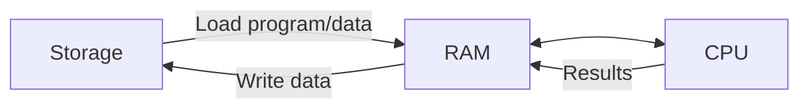

# CPU, RAM, and Storage

## Introduction
CPU, RAM, and storage are three core resources. They affect how quickly applications execute, how much active data they can hold, and how much data they can retain.

## Definition
The CPU executes instructions, RAM provides fast volatile working memory, and storage provides persistent data capacity.

## How It Works
Programs are loaded from storage into memory. The CPU processes instructions and data, while the OS coordinates memory allocation and storage access. If memory pressure grows, Linux may reclaim cache or use swap.

## Important Components
- **CPU cores:** Can execute work in parallel; actual throughput depends on workload.
- **RAM:** Holds active program data and filesystem cache.
- **Swap:** Disk-backed memory support; heavy use can be slow.
- **Disk I/O:** Reads and writes data to storage.
- **Capacity vs performance:** Free space is not the same as fast I/O.

## Real-World Example
A database may need more RAM for caching, while a build job may be CPU-bound and a logging service may fail when its disk fills.

## Why DevOps Engineers Need This
Resource monitoring helps choose VM sizes, set container requests and limits, diagnose slow builds, and prevent full-disk incidents.

## Diagram


## Linux Commands and Examples
### `lscpu`
Inspect CPU details.

```bash
lscpu
```

### `top`
Observe processes and resource use interactively.

```bash
top
```

### `free -h`
Inspect memory and swap.

```bash
free -h
```

### `vmstat 1`
Sample memory, CPU, and I/O-related statistics once per second; stop with Ctrl+C.

```bash
vmstat 1
```

### `df -h`
Check filesystem capacity.

```bash
df -h
```

Some commands may not be installed in a minimal environment. Output and available options vary by distribution and machine.

## Troubleshooting Scenarios
Check sustained CPU usage with `top`, memory pressure with `free -h` and `vmstat 1`, and filesystem capacity with `df -h`. Do not diagnose memory solely from the `free` column; Linux uses memory for cache.

## Hands-On Lab
Capture `lscpu`, `free -h`, and `df -h` output. Identify one potential resource bottleneck and explain what additional evidence you would collect before taking action.

## Interview Questions and Answers
### 1. What is a CPU-bound workload?
One whose performance is limited mainly by CPU processing capacity.

### 2. What does volatile memory mean?
Its contents are not retained when power is removed.

### 3. What is swap?
Disk space used as backing for memory pages when needed.

### 4. Does free disk space prove storage is fast?
No; latency and throughput also matter.

### 5. Which command summarizes memory?
`free -h`, with further investigation using tools such as `vmstat` or `top`.

## Practice Assignment
Write a one-page incident note for each scenario: high CPU, low available memory, and a filesystem at 100%. Include safe diagnostic commands and likely next checks.

## Key Takeaways
- CPU, RAM, and storage are three core resources. They affect how quickly applications execute, how much active data they can hold, and how much data they can retain.
- Understand the components and how to inspect them safely.
- Gather evidence before making changes.
- Connect this concept to production reliability and security.

## Further Learning
Linux processes, monitoring, filesystems, cloud instance sizing.
