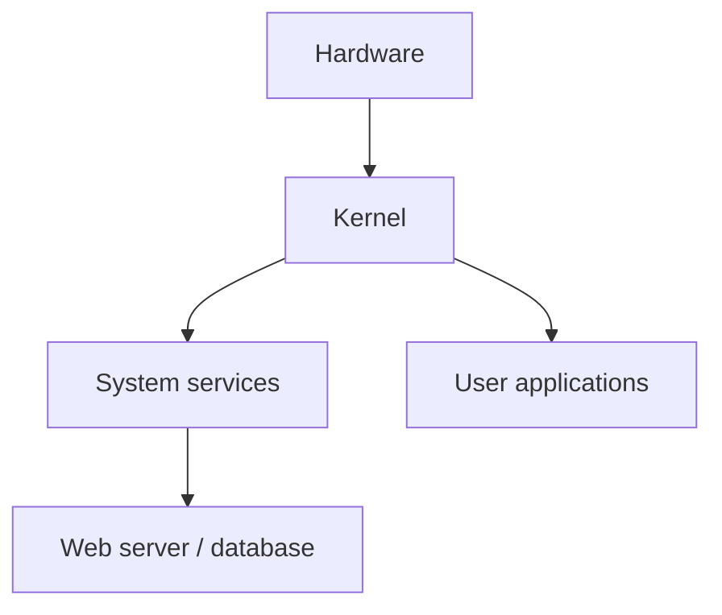

# Operating Systems

## Introduction
An operating system manages computer resources and provides common services that applications need. Linux, Windows, and macOS are examples.

## Definition
An operating system coordinates CPU scheduling, memory, storage, devices, users, networking, and application execution.

## How It Works
The kernel manages privileged system resources. User-space programs request services through system calls. The OS also provides filesystems, networking tools, libraries, and service management.

## Important Components
- **Kernel:** Core component that manages hardware and system resources.
- **User space:** Where most applications and utilities run.
- **Filesystem:** Organizes files and directories.
- **Service manager:** Starts and monitors system services; Ubuntu commonly uses systemd.
- **Package manager:** Installs and updates software; Ubuntu uses APT.

## Real-World Example
A Linux web server runs the OS, Apache or Nginx, monitoring agents, and application processes. A service can fail even when the machine itself is running.

## Why DevOps Engineers Need This
DevOps engineers automate package installation, configure services, manage permissions, inspect logs, and maintain Linux servers.

## Diagram


## Linux Commands and Examples
### `uname -a`
Show kernel and system information.

```bash
uname -a
```

### `cat /etc/os-release`
Show distribution details.

```bash
cat /etc/os-release
```

### `uptime`
Show uptime and load averages.

```bash
uptime
```

### `systemctl --failed`
List failed systemd units.

```bash
systemctl --failed
```

### `systemctl status ssh`
Check the SSH service if installed; the unit name may vary.

```bash
systemctl status ssh
```

Some commands may not be installed in a minimal environment. Output and available options vary by distribution and machine.

## Troubleshooting Scenarios
If a service is unavailable, verify the host is reachable, inspect `systemctl status <service>`, then check `journalctl -u <service>`. A missing service unit may mean the software is not installed or uses another unit name.

## Hands-On Lab
Run `uname -a`, `cat /etc/os-release`, `uptime`, and `systemctl --failed`. Record your distribution and kernel version, then explain any failed units shown.

## Interview Questions and Answers
### 1. What is an operating system?
Software that manages system resources and provides services to applications.

### 2. What is the kernel?
The core of the OS that manages privileged resources.

### 3. What is user space?
The execution environment for most applications and utilities.

### 4. What does systemd do on Ubuntu?
It commonly acts as the init system and service manager.

### 5. What is a package manager?
A tool that installs, updates, and removes software packages.

## Practice Assignment
Document how you would investigate an application that fails to start after a reboot. Include OS, service, and log checks.

## Key Takeaways
- An operating system manages computer resources and provides common services that applications need. Linux, Windows, and macOS are examples.
- Understand the components and how to inspect them safely.
- Gather evidence before making changes.
- Connect this concept to production reliability and security.

## Further Learning
Boot process, processes, permissions, filesystems, service logs.
