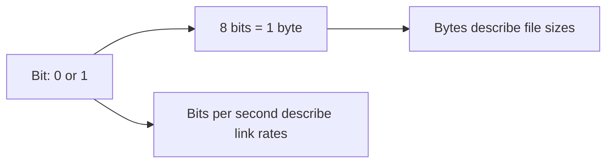

# Bits, Bytes, and Binary

## Introduction
Computers represent information using binary digits. Understanding bits and bytes helps with memory sizes, storage units, network speeds, permissions, and IP subnetting.

## Definition
A bit is a binary digit (`0` or `1`). A byte is conventionally eight bits. Decimal and binary size units are different: GB uses powers of 1000, while GiB uses powers of 1024.

## How It Works
Binary uses base 2. For example, `101` equals 1×4 + 0×2 + 1×1 = decimal 5. Each binary position represents a power of two.

## Important Components
- **Bit (b):** One binary digit.
- **Byte (B):** Eight bits.
- **Mbps:** Megabits per second, commonly used for network rates.
- **MB/s:** Megabytes per second, commonly used for data transfer rates.
- **GB and GiB:** Decimal and binary capacity units, respectively.

## Real-World Example
A 100 Mbps connection has a theoretical raw rate of 12.5 MB/s before protocol overhead because 8 bits make one byte.

## Why DevOps Engineers Need This
These units appear in cloud bandwidth, disk capacity, memory sizing, file transfer estimates, and network calculations.

## Diagram


## Linux Commands and Examples
### `python3 -c 'print(bin(5))'`
Display decimal 5 in binary.

```bash
python3 -c 'print(bin(5))'
```

### `free -h`
View memory using human-readable units.

```bash
free -h
```

### `df -h`
View filesystem sizes and usage.

```bash
df -h
```

### `du -sh .`
Estimate the current directory size.

```bash
du -sh .
```

Some commands may not be installed in a minimal environment. Output and available options vary by distribution and machine.

## Troubleshooting Scenarios
When a transfer seems slower than expected, check whether the stated speed is in bits or bytes, account for protocol overhead, and compare actual throughput with the theoretical maximum.

## Hands-On Lab
Use `python3 -c 'print(bin(1), bin(8), bin(10))'`. Explain each result. Compare a 100 Mbps link with a theoretical MB/s value.

## Interview Questions and Answers
### 1. What values can a bit hold?
Either 0 or 1.

### 2. How many bits are in a byte?
Conventionally eight.

### 3. What is binary 101 in decimal?
Five.

### 4. What is the difference between Mbps and MB/s?
Mbps measures megabits per second; MB/s measures megabytes per second.

### 5. How do GB and GiB differ?
GB is decimal (1000-based); GiB is binary (1024-based).

## Practice Assignment
Create a small reference table for bits, bytes, KB, KiB, MB, MiB, Mbps, and MB/s. Include one practical DevOps example for each relevant unit.

## Key Takeaways
- Computers represent information using binary digits. Understanding bits and bytes helps with memory sizes, storage units, network speeds, permissions, and IP subnetting.
- Understand the components and how to inspect them safely.
- Gather evidence before making changes.
- Connect this concept to production reliability and security.

## Further Learning
IP subnetting, storage capacity, data transfer, Linux permissions.
