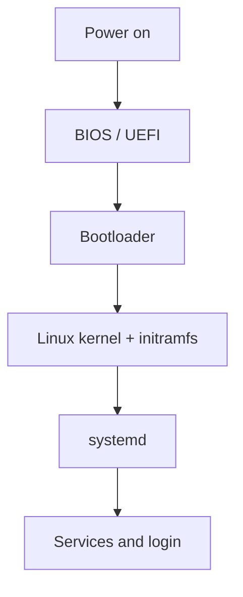

# The Linux Boot Process

## Introduction
Booting is the sequence that takes a computer from power-on to a usable operating system and running services.

## Definition
The boot process includes firmware initialization, bootloader execution, kernel startup, initialization of the root filesystem, and startup of system services.

## How It Works
1. Power is applied. 2. BIOS/UEFI initializes hardware. 3. Firmware selects a boot device. 4. GRUB or another bootloader loads the kernel and initramfs. 5. The kernel initializes core resources. 6. The init system, commonly systemd on Ubuntu, starts services. 7. Users and applications can log in or run.

## Important Components
- **BIOS/UEFI:** Firmware that initializes hardware and starts the boot path.
- **GRUB:** A common Linux bootloader.
- **Kernel:** Initializes and manages OS resources.
- **initramfs:** Temporary early userspace used during startup.
- **systemd:** Common Ubuntu init and service manager.

## Real-World Example
A cloud VM may boot successfully while Apache fails to start because its configuration is invalid or its database dependency is unavailable.

## Why DevOps Engineers Need This
Understanding startup order helps troubleshoot failed services, boot loops, broken mounts, and applications that do not recover after reboot.

## Diagram


## Linux Commands and Examples
### `uptime`
Show how long the system has been running.

```bash
uptime
```

### `who -b`
Show the last system boot time when supported.

```bash
who -b
```

### `systemctl --failed`
List failed systemd units.

```bash
systemctl --failed
```

### `journalctl -b -p err`
Show error-priority journal entries from the current boot; permissions may restrict access.

```bash
journalctl -b -p err
```

Some commands may not be installed in a minimal environment. Output and available options vary by distribution and machine.

## Troubleshooting Scenarios
If the machine boots but an application is unavailable, check `systemctl --failed`, `systemctl status <service>`, and `journalctl -u <service> -b`. If the OS itself does not boot, use the provider console or recovery environment and avoid editing boot files without a recovery plan.

## Hands-On Lab
Run `who -b`, `uptime`, and `systemctl --failed`. Compare boot time with uptime and note any failed units.

## Interview Questions and Answers
### 1. What is firmware's role in booting?
It initializes hardware and begins the boot process.

### 2. What does GRUB do?
It loads the selected kernel and boot configuration.

### 3. What is initramfs used for?
It provides an early userspace environment needed to initialize the system and access the root filesystem.

### 4. What is systemd?
A common Linux init system and service manager.

### 5. Which command lists failed systemd units?
`systemctl --failed`.

## Practice Assignment
Write a troubleshooting runbook for a service that does not automatically start after a VM reboot.

## Key Takeaways
- Booting is the sequence that takes a computer from power-on to a usable operating system and running services.
- Understand the components and how to inspect them safely.
- Gather evidence before making changes.
- Connect this concept to production reliability and security.

## Further Learning
BIOS vs UEFI, systemd, logs, Linux services.
