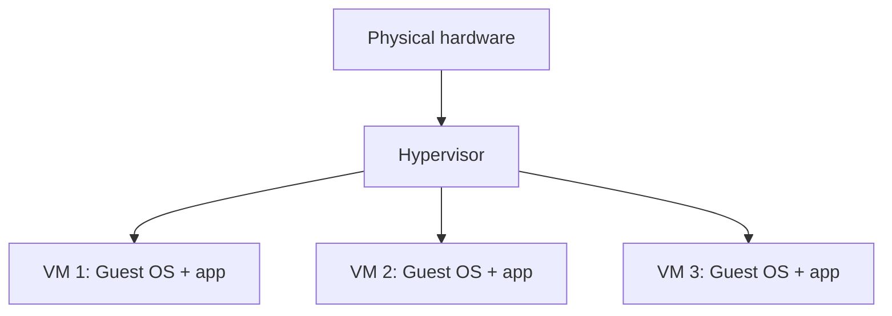

# Virtualization

## Introduction
Virtualization allows multiple virtual machines to share one physical host while behaving like separate computers.

## Definition
Virtualization abstracts physical computing resources so software-defined machines can receive virtual CPUs, memory, storage, and network interfaces.

## How It Works
A hypervisor manages access to host hardware. Each VM receives virtual resources and runs a guest operating system. The hypervisor schedules resources and keeps VMs separated according to its design and configuration.

## Important Components
- **Hypervisor:** Creates and runs virtual machines.
- **Host:** The physical or underlying machine.
- **Guest OS:** The operating system running inside a VM.
- **Virtual disk:** A file or storage volume presented as a disk.
- **Virtual NIC:** A network interface presented to the VM.

## Real-World Example
A cloud compute instance commonly runs as a virtualized workload. A team can create separate test and production VMs with different resource allocations.

## Why DevOps Engineers Need This
Virtualization enables repeatable environments, isolation, snapshots, infrastructure automation, and flexible resource allocation.

## Diagram


## Linux Commands and Examples
### `systemd-detect-virt`
Detect virtualization when the environment exposes that information.

```bash
systemd-detect-virt
```

### `lscpu`
Inspect CPU details, which may include virtualization hints.

```bash
lscpu
```

### `uname -a`
Show kernel/system information.

```bash
uname -a
```

Some commands may not be installed in a minimal environment. Output and available options vary by distribution and machine.

## Troubleshooting Scenarios
A VM can be slow because of its own CPU or memory limits, noisy neighbors, storage latency, or network issues. Check guest metrics first, then compare with provider-side metrics where available.

## Hands-On Lab
Run `systemd-detect-virt` and `lscpu` on your Ubuntu system. Record what they reveal and note that cloud VMs may hide some physical-host details.

## Interview Questions and Answers
### 1. What is a hypervisor?
Software or firmware that creates and manages VMs.

### 2. What is a guest OS?
The operating system running inside a VM.

### 3. What is a virtual NIC?
A network interface presented to a virtual machine.

### 4. Why use VMs?
For isolation, flexible provisioning, and running separate OS environments.

### 5. Does virtualization guarantee unlimited resources?
No; VMs are constrained by allocated resources and underlying capacity.

## Practice Assignment
Draw an architecture with one host and three VMs. Explain which resources are shared and which guest-level settings are isolated.

## Key Takeaways
- Virtualization allows multiple virtual machines to share one physical host while behaving like separate computers.
- Understand the components and how to inspect them safely.
- Gather evidence before making changes.
- Connect this concept to production reliability and security.

## Further Learning
Containers vs VMs, cloud computing, resource monitoring.
