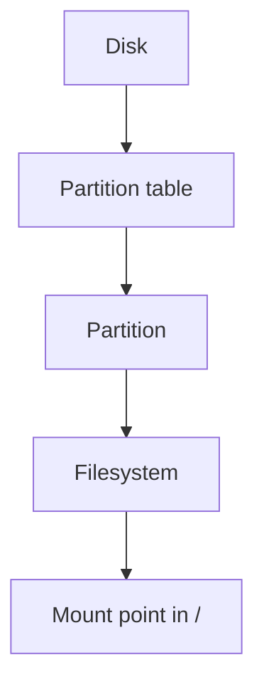

# Filesystems and Disk Partitions

## Introduction
Storage devices hold data, partitions divide disk space into regions, and filesystems organize files and directories. Mount points make filesystems accessible within the Linux directory tree.

## Definition
A partition is a defined region of a block device. A filesystem defines how files and metadata are stored. A mount point is a directory where a filesystem is attached to the directory tree.

## How It Works
The OS detects a block device, reads its partition layout if present, recognizes a filesystem, and mounts it at a directory. Applications access files through paths rather than needing to know the physical storage layout.

## Important Components
- **Block device:** A device that exposes data in addressable blocks.
- **Partition table:** Describes partitions on a disk.
- **Filesystem:** Examples include ext4, XFS, NTFS, and exFAT.
- **Mount point:** Directory where a filesystem is accessible.
- **Capacity and inodes:** Filesystems can run out of blocks or inodes.

## Real-World Example
A separate filesystem mounted at `/var/log` can isolate log growth from the root filesystem, though it still needs capacity monitoring.

## Why DevOps Engineers Need This
Full disks can break logging, package installs, deployments, and databases. Persistent volumes and mounted storage are important in containers and cloud systems.

## Diagram


## Linux Commands and Examples
### `lsblk -f`
List block devices and filesystem information.

```bash
lsblk -f
```

### `df -hT`
Show mounted filesystem type and capacity.

```bash
df -hT
```

### `findmnt`
List mounted filesystems.

```bash
findmnt
```

### `du -sh "$HOME"`
Estimate space used by the home directory.

```bash
du -sh "$HOME"
```

Some commands may not be installed in a minimal environment. Output and available options vary by distribution and machine.

## Troubleshooting Scenarios
If a write fails, check `df -hT` for full filesystems and `df -i` for inode exhaustion. Use `du` to find large directories, then determine what data is safe to clean. Do not delete unknown files or format disks as a first response.

## Hands-On Lab
Run `lsblk -f`, `df -hT`, and `findmnt`. Identify the filesystem mounted at `/` and record available space.

## Interview Questions and Answers
### 1. What is a partition?
A defined region of a disk or block device.

### 2. What is a filesystem?
The structure and rules used to organize files and metadata.

### 3. What is a mount point?
A directory where a filesystem is attached.

### 4. What does `df -h` show?
Filesystem capacity and usage in human-readable units.

### 5. Can a filesystem run out of inodes while space remains?
Yes; inode exhaustion can prevent new files from being created.

## Practice Assignment
Write a runbook for a server whose root filesystem reaches 95% usage. Include safe inspection steps and a verification plan.

## Key Takeaways
- Storage devices hold data, partitions divide disk space into regions, and filesystems organize files and directories. Mount points make filesystems accessible within the Linux directory tree.
- Understand the components and how to inspect them safely.
- Gather evidence before making changes.
- Connect this concept to production reliability and security.

## Further Learning
HDD/SSD/NVMe, Linux directories, persistent volumes, log rotation.
