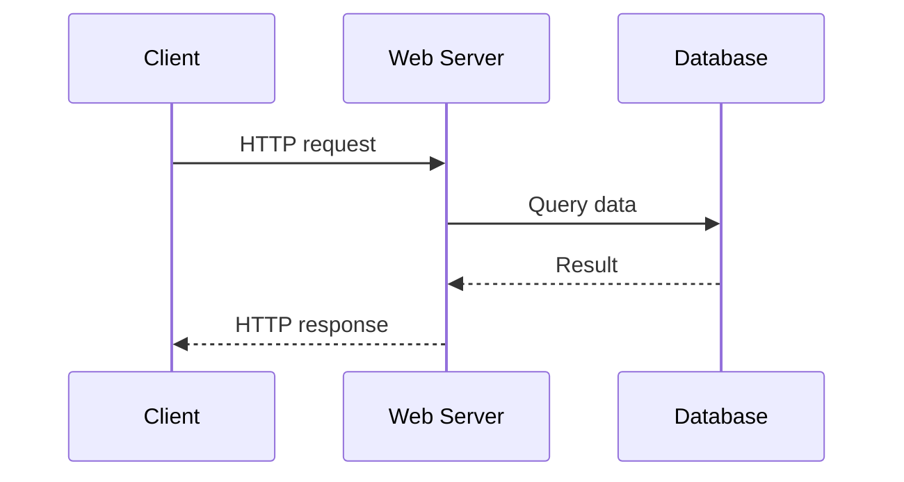

# Client–Server Architecture

## Introduction
In client–server architecture, a client requests a service and a server handles the request and returns a response.

## Definition
A client is a program or system that initiates a request; a server is a program or system that listens for requests and provides a service.

## How It Works
A client identifies the server, connects using a protocol, sends a request, and waits for a response. The server validates and processes the request, may call other services or a database, and returns a result.

## Important Components
- **Client:** Browser, CLI, mobile app, or another service.
- **Server:** Software that accepts and processes requests.
- **Protocol:** Rules for communication, such as HTTP.
- **Port:** Identifies a transport endpoint on a host.
- **Dependency:** Another service required to complete a request.

## Real-World Example
A browser requests a page from a web server; the web server may call an application service, which queries a database before returning the page.

## Why DevOps Engineers Need This
Understanding request paths helps teams debug timeouts, service dependencies, reverse proxies, API calls, and database connection failures.

## Diagram


## Linux Commands and Examples
### `curl -I https://example.com`
Inspect HTTP response headers.

```bash
curl -I https://example.com
```

### `ss -tuln`
Inspect listening sockets.

```bash
ss -tuln
```

### `getent hosts example.com`
Resolve a hostname.

```bash
getent hosts example.com
```

### `ip route`
Inspect routes.

```bash
ip route
```

Some commands may not be installed in a minimal environment. Output and available options vary by distribution and machine.

## Troubleshooting Scenarios
When a request fails, determine whether the issue is name resolution, connection establishment, TLS, application processing, or a backend dependency. Check each hop instead of assuming the client or server alone is responsible.

## Hands-On Lab
Run `curl -I https://example.com`. Identify the destination, protocol, response status, and two headers. Draw the request path for a simple website.

## Interview Questions and Answers
### 1. What is a client?
A program or system that initiates a request for a service.

### 2. What is a server?
A program or system that provides a service to clients.

### 3. What is a protocol?
An agreed set of communication rules.

### 4. Can a server depend on another server?
Yes; for example, a web server may depend on a database.

### 5. Why troubleshoot each hop?
Because failures can occur in DNS, networking, TLS, application code, or dependencies.

## Practice Assignment
Design a three-component web request flow (client, web server, database). List one possible failure and one diagnostic check for each connection.

## Key Takeaways
- In client–server architecture, a client requests a service and a server handles the request and returns a response.
- Understand the components and how to inspect them safely.
- Gather evidence before making changes.
- Connect this concept to production reliability and security.

## Further Learning
HTTP/HTTPS, IP addresses and ports, load balancing, monitoring.
