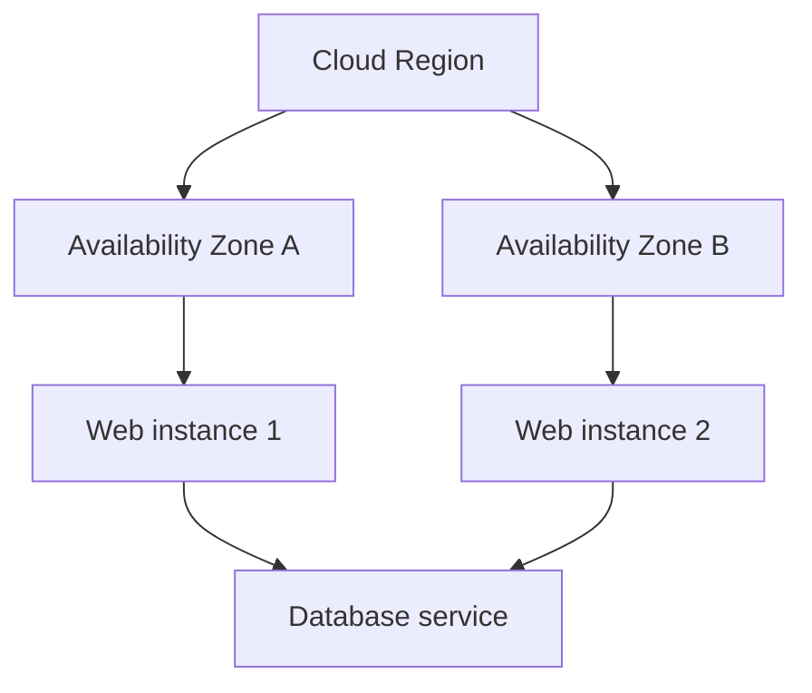

# Data Centers and Cloud Computing

## Introduction
A data center houses computing, networking, power, cooling, and security infrastructure. Cloud computing provides computing resources through services and APIs rather than requiring every customer to own the physical equipment.

## Definition
Cloud computing is on-demand access to configurable resources such as compute, storage, networking, and managed services, often with usage-based billing.

## How It Works
A user provisions a resource through a console, API, or Infrastructure as Code. The provider allocates underlying infrastructure, while the customer configures the portions of the stack assigned to them and monitors usage, security, and cost.

## Important Components
- **Region:** A geographic cloud area.
- **Availability Zone:** A distinct location within a region designed to support resilience.
- **Compute:** VMs, containers, or serverless execution.
- **Storage:** Object, block, or file storage.
- **IAM:** Identity and permissions for cloud resources.
- **Billing:** Measures resource use and associated cost.

## Real-World Example
A web service may run two frontend instances in separate Availability Zones and use a database in private networking, with access limited by identity and network policies.

## Why DevOps Engineers Need This
Cloud DevOps relies on automation, observability, security, resilient architecture, and cost control.

## Diagram


## Linux Commands and Examples
### `uname -a`
Inspect the guest OS; does not identify every cloud detail.

```bash
uname -a
```

### `ip addr`
Inspect local interfaces.

```bash
ip addr
```

### `df -h`
Inspect mounted storage.

```bash
df -h
```

### `free -h`
Inspect memory.

```bash
free -h
```

Some commands may not be installed in a minimal environment. Output and available options vary by distribution and machine.

## Troubleshooting Scenarios
A cloud service can fail because of application configuration, network rules, IAM permissions, quotas, unavailable dependencies, or cost controls. Check provider events and metrics alongside guest operating-system evidence.

## Hands-On Lab
Draw a cloud architecture with a load balancer, two web instances in separate Availability Zones, and a private database. Label network boundaries and traffic directions.

## Interview Questions and Answers
### 1. What is a cloud region?
A geographic area containing cloud infrastructure.

### 2. Why use multiple Availability Zones?
To reduce dependence on one location and improve resilience.

### 3. What is IaaS?
A service model where customers manage much of the OS and application stack on provisioned infrastructure.

### 4. Does cloud automatically mean secure?
No; security responsibilities are shared and configuration still matters.

### 5. Why monitor cloud costs?
Resources may continue generating charges while provisioned or in use.

## Practice Assignment
Write a short design note explaining how you would improve availability while limiting public exposure and unnecessary cloud costs.

## Key Takeaways
- A data center houses computing, networking, power, cooling, and security infrastructure. Cloud computing provides computing resources through services and APIs rather than requiring every customer to own the physical equipment.
- Understand the components and how to inspect them safely.
- Gather evidence before making changes.
- Connect this concept to production reliability and security.

## Further Learning
Virtualization, VPC networking, IAM, load balancing, backups.
