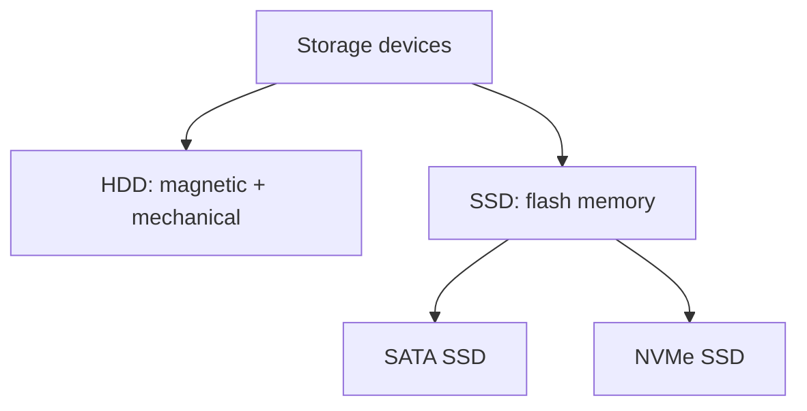

# HDD, SSD, and NVMe

## Introduction
HDDs and SSDs are storage device types. NVMe is a storage protocol commonly used by high-performance SSDs; it is not a synonym for every SSD.

## Definition
An HDD stores data magnetically on rotating platters. An SSD uses flash memory. NVMe is a protocol designed for non-volatile memory devices, commonly connected over PCI Express.

## How It Works
Storage requests travel through the operating system and device interface. Mechanical HDDs must move heads to access data; SSDs access flash electronically. Performance depends on latency, throughput, queue depth, device type, and workload.

## Important Components
- **HDD:** Mechanical storage, often cost-effective for capacity.
- **SATA SSD:** Flash storage using the SATA interface.
- **NVMe SSD:** Flash storage using NVMe, commonly over PCIe.
- **Latency:** Time taken for an operation.
- **Throughput:** Amount of data transferred per unit time.

## Real-World Example
A database with frequent random reads may benefit from lower-latency storage, while a backup archive may prioritize capacity and cost.

## Why DevOps Engineers Need This
Storage performance affects databases, build pipelines, log processing, VM responsiveness, and application startup.

## Diagram


## Linux Commands and Examples
### `lsblk -o NAME,TYPE,SIZE,ROTA,MODEL`
List devices and available device properties.

```bash
lsblk -o NAME,TYPE,SIZE,ROTA,MODEL
```

### `df -hT`
Inspect mounted filesystem capacity and type.

```bash
df -hT
```

### `iostat -xz 1`
If sysstat is installed, sample device I/O statistics; stop with Ctrl+C.

```bash
iostat -xz 1
```

Some commands may not be installed in a minimal environment. Output and available options vary by distribution and machine.

## Troubleshooting Scenarios
Slow storage may be caused by I/O saturation, latency, a full filesystem, or the application itself. Use available OS and cloud-provider metrics; virtualized environments may not reveal the physical device type.

## Hands-On Lab
Run `lsblk -o NAME,TYPE,SIZE,ROTA,MODEL`. If `iostat` is available, observe it briefly. Record what you can and cannot infer from the output.

## Interview Questions and Answers
### 1. How does an HDD store data?
Magnetically on rotating platters.

### 2. What does SSD mean?
Solid-state drive, which uses flash memory rather than spinning platters.

### 3. Is NVMe a type of flash memory?
No; it is a storage protocol commonly used by SSDs.

### 4. What is latency?
The time taken for an operation or response.

### 5. Can a VM reveal its exact physical disk?
Not always; virtualization can abstract underlying hardware details.

## Practice Assignment
Recommend a storage type for three workloads: a database, a large media archive, and a developer test VM. Explain capacity, latency, cost, and workload trade-offs.

## Key Takeaways
- HDDs and SSDs are storage device types. NVMe is a storage protocol commonly used by high-performance SSDs; it is not a synonym for every SSD.
- Understand the components and how to inspect them safely.
- Gather evidence before making changes.
- Connect this concept to production reliability and security.

## Further Learning
Filesystems, disk monitoring, database performance, cloud block storage.
