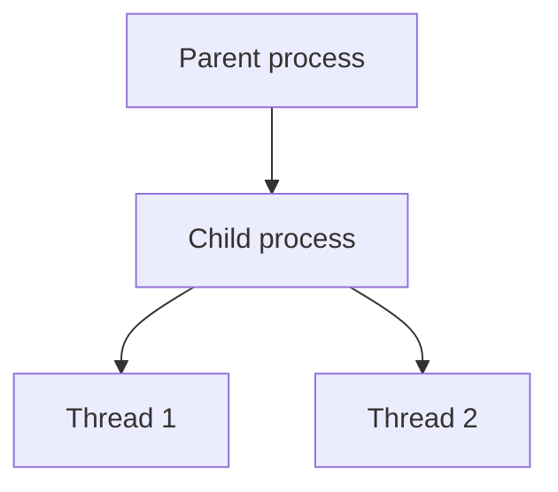

# Processes and Threads

## Introduction
A process is a running program instance. A thread is an execution path within a process. Linux uses processes and threads to run services and applications.

## Definition
A process has its own process identity and resources; threads within a process generally share its address space while maintaining separate execution state.

## How It Works
The kernel schedules runnable tasks on CPU cores. A process can create child processes and threads. The OS manages their lifecycle, resource use, permissions, and communication.

## Important Components
- **PID:** Process identifier.
- **PPID:** Parent process identifier.
- **Thread:** Execution path within a process.
- **Signal:** Notification used to request or control process behavior.
- **Zombie:** A terminated child whose exit status has not yet been collected by its parent.

## Real-World Example
An Apache or application service may spawn multiple workers. A stuck worker can consume resources or delay requests, so administrators inspect process state and logs.

## Why DevOps Engineers Need This
Process knowledge helps diagnose CPU spikes, hung deployments, service failures, zombie processes, and resource limits.

## Diagram


## Linux Commands and Examples
### `ps -ef`
List processes.

```bash
ps -ef
```

### `top`
Monitor processes interactively.

```bash
top
```

### `pgrep -a ssh`
Find processes matching a name; output depends on running services.

```bash
pgrep -a ssh
```

### `sleep 300 &`
Start a harmless background process for the lab.

```bash
sleep 300 &
```

### `jobs`
List jobs in the current shell.

```bash
jobs
```

Some commands may not be installed in a minimal environment. Output and available options vary by distribution and machine.

## Troubleshooting Scenarios
Use `ps`, `top`, and service logs to investigate a process. `SIGTERM` requests graceful termination; `SIGKILL` forces termination and should not be the first choice. Never kill an unfamiliar process without understanding its role.

## Hands-On Lab
Start `sleep 300 &`, find its PID with `pgrep -a sleep`, inspect it using `ps -p <PID> -o pid,ppid,stat,cmd`, then stop only the process you started with `kill <PID>`.

## Interview Questions and Answers
### 1. What is a process?
A running instance of a program.

### 2. What does PID mean?
Process identifier.

### 3. How do threads differ from processes?
Threads within a process generally share its address space; separate processes have separate process address spaces.

### 4. What does SIGTERM do?
Requests that a process terminate gracefully.

### 5. What is a zombie process?
A terminated child process whose exit status has not yet been collected by its parent.

## Practice Assignment
Write a checklist for investigating a service that consumes excessive CPU. Include process identification, service ownership, logs, and verification.

## Key Takeaways
- A process is a running program instance. A thread is an execution path within a process. Linux uses processes and threads to run services and applications.
- Understand the components and how to inspect them safely.
- Gather evidence before making changes.
- Connect this concept to production reliability and security.

## Further Learning
Signals, systemd services, CPU monitoring, process limits.
