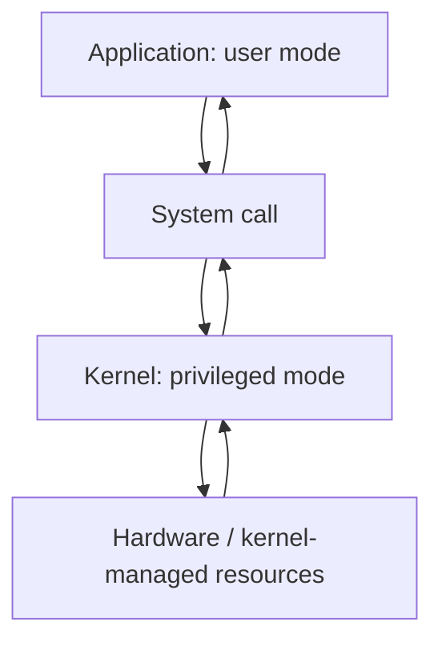

# User Mode and Kernel Mode

## Introduction
Modern operating systems separate ordinary application execution from privileged kernel execution. This helps protect system resources and isolate failures.

## Definition
User mode restricts an application's direct access to protected resources. Kernel mode allows the operating-system kernel to perform privileged operations.

## How It Works
Applications run with limited privileges. When they need services such as file access or network operations, they make system calls. The kernel validates requests and performs permitted operations.

## Important Components
- **User mode:** Restricted execution context for applications.
- **Kernel mode:** Privileged execution context for the kernel.
- **System call:** Interface through which an application requests a kernel service.
- **Driver:** Kernel or user-space component that interacts with a device.
- **Privilege boundary:** Separation that limits direct access to critical resources.

## Real-World Example
A web server can read files only when its OS identity and permissions allow it; it should not need unrestricted kernel access to serve pages.

## Why DevOps Engineers Need This
This distinction helps explain permissions, kernel logs, container isolation, system calls, and why privileged workloads need careful review.

## Diagram


## Linux Commands and Examples
### `uname -r`
Show the running kernel version.

```bash
uname -r
```

### `dmesg --level=err,warn | tail -n 20`
Inspect recent kernel warning/error messages where permissions allow.

```bash
dmesg --level=err,warn | tail -n 20
```

### `strace -c true`
If strace is installed, summarize system calls made by a simple command.

```bash
strace -c true
```

Some commands may not be installed in a minimal environment. Output and available options vary by distribution and machine.

## Troubleshooting Scenarios
If a command reports permission denied, determine which user runs it and which file or capability is required. Do not solve access issues by granting broad privileges or running every application as root.

## Hands-On Lab
Run `uname -r`. If `strace` is available, run `strace -c true` and observe that a simple command invokes system calls. Do not change kernel parameters.

## Interview Questions and Answers
### 1. Why does user mode exist?
To restrict applications from directly accessing protected resources.

### 2. What is kernel mode?
A privileged execution mode used by the OS kernel.

### 3. What is a system call?
An interface for applications to request kernel services.

### 4. Does every application need kernel mode?
No; applications generally run in user mode and request services when needed.

### 5. Why avoid unnecessary root privileges?
They increase the potential impact of mistakes or compromise.

## Practice Assignment
Explain why running a container with elevated privileges can increase risk compared with a normal unprivileged container.

## Key Takeaways
- Modern operating systems separate ordinary application execution from privileged kernel execution. This helps protect system resources and isolate failures.
- Understand the components and how to inspect them safely.
- Gather evidence before making changes.
- Connect this concept to production reliability and security.

## Further Learning
Linux permissions, containers, capabilities, kernel logs.
