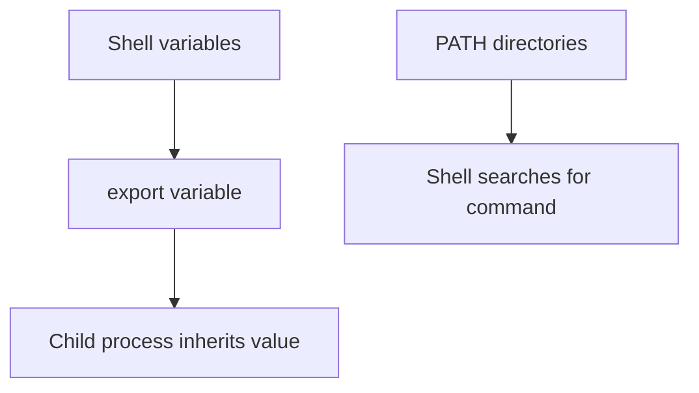

# Environment Variables and PATH

## Introduction
Environment variables pass configuration values to programs. `PATH` tells a shell which directories to search when a command is entered without its full path.

## Definition
An environment variable is a named value available to a process. Child processes inherit exported environment variables from their parent environment.

## How It Works
A shell stores variables. `export` marks a variable for inheritance by child processes. When a command is typed, the shell searches directories listed in `PATH` unless a path is explicitly provided.

## Important Components
- **HOME:** Current user's home directory in many environments.
- **USER:** A common variable containing the username.
- **PATH:** Colon-separated directories searched for commands.
- **export:** Exports a shell variable to child processes.
- **Scope:** A variable may exist only in one shell session unless configured persistently.

## Real-World Example
A CI pipeline may set an environment variable to choose an application mode. Secrets should be injected using approved secret-management features and not printed into build logs.

## Why DevOps Engineers Need This
Environment variables configure scripts, CI jobs, containers, and application runtimes. Misconfigured PATH or missing variables can cause deployments to fail.

## Diagram


## Linux Commands and Examples
### `echo "$HOME"`
Print the home-directory variable.

```bash
echo "$HOME"
```

### `printf '%s\n' "$PATH"`
Print each PATH string as one line only if transformed; the basic command prints the full value.

```bash
printf '%s\n' "$PATH"
```

### `command -v python3`
Show the command path selected by the shell.

```bash
command -v python3
```

### `export DEMO_MESSAGE='Hello DevOps'; echo "$DEMO_MESSAGE"`
Create and print a temporary environment variable.

```bash
export DEMO_MESSAGE='Hello DevOps'; echo "$DEMO_MESSAGE"
```

Some commands may not be installed in a minimal environment. Output and available options vary by distribution and machine.

## Troubleshooting Scenarios
If a command is not found, check `command -v <command>`, inspect `PATH`, and verify the program is installed. If an application lacks configuration, check how and where the variable is set without exposing secrets.

## Hands-On Lab
Export `DEMO_MESSAGE='Hello DevOps'`, print it, then open a new terminal and check whether it exists there. Explain the scope difference.

## Interview Questions and Answers
### 1. What is an environment variable?
A named value available to a process.

### 2. What does PATH do?
Lists directories the shell searches for commands.

### 3. What does export do?
Makes a shell variable available to child processes.

### 4. Do shell variables always persist in new terminals?
No; persistence depends on shell startup configuration or another configuration mechanism.

### 5. Why avoid printing secrets?
Logs may be retained or exposed to users who should not have access to credentials.

## Practice Assignment
Create a small script that reads a non-secret environment variable and prints a fallback message if it is unset. Do not store passwords or tokens in the script.

## Key Takeaways
- Environment variables pass configuration values to programs. `PATH` tells a shell which directories to search when a command is entered without its full path.
- Understand the components and how to inspect them safely.
- Gather evidence before making changes.
- Connect this concept to production reliability and security.

## Further Learning
Shell scripting, CI/CD variables, Docker environment configuration, secret management.
