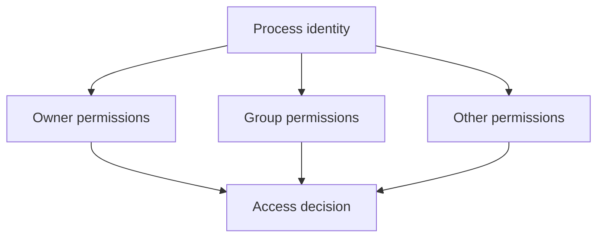

# Users, Groups, and Permissions

## Introduction
Linux users, groups, and file permissions control access to files, directories, and system resources.

## Definition
A user identity represents an account; groups collect users for shared access; permission bits specify read, write, and execute access for the owner, group, and others.

## How It Works
When a process accesses a file, Linux checks its identity, group memberships, permission bits, and any applicable additional access controls. Root and capabilities can alter the normal permission model.

## Important Components
- **Owner:** User associated with a file.
- **Group:** Group associated with a file.
- **r/w/x:** Read, write, and execute permissions.
- **chmod:** Changes permission bits.
- **chown:** Changes ownership; normally requires appropriate privileges.

## Real-World Example
A deployment user may need write access to a release directory but should not need unrestricted root access to the entire server.

## Why DevOps Engineers Need This
Least privilege reduces risk. Incorrect ownership or permissions can break deployments, while overly broad permissions can expose data or credentials.

## Diagram


## Linux Commands and Examples
### `whoami`
Show the current username.

```bash
whoami
```

### `id`
Show user ID and group memberships.

```bash
id
```

### `ls -l`
Show file permissions and ownership.

```bash
ls -l
```

### `stat /etc/passwd`
Show metadata for a system file.

```bash
stat /etc/passwd
```

### `chmod 640 example.txt`
Set owner read/write, group read, others no access; use only on a test file.

```bash
chmod 640 example.txt
```

Some commands may not be installed in a minimal environment. Output and available options vary by distribution and machine.

## Troubleshooting Scenarios
For permission errors, inspect `id`, `ls -l`, and `namei -l <path>` if available. Check each parent directory's traversal permission. Avoid `chmod -R 777` as a shortcut.

## Hands-On Lab
Run `mkdir -p ~/permission-lab && cd ~/permission-lab && touch example.txt && chmod 640 example.txt && ls -l example.txt`. Explain who can read and write the file.

## Interview Questions and Answers
### 1. What does `r` mean?
Read permission.

### 2. What does `x` mean on a directory?
Permission to traverse/search the directory.

### 3. What does mode 640 mean?
Owner read/write, group read, others no permissions.

### 4. What does least privilege mean?
Grant only the access required for a task.

### 5. Why is `chmod -R 777` risky?
It grants broad access recursively and can expose or alter sensitive files.

## Practice Assignment
Design permissions for a shared deployment directory. Define which account owns it, which group can write, and how you would verify access without granting everyone full permissions.

## Key Takeaways
- Linux users, groups, and file permissions control access to files, directories, and system resources.
- Understand the components and how to inspect them safely.
- Gather evidence before making changes.
- Connect this concept to production reliability and security.

## Further Learning
Linux users and groups, sudo, SSH authentication, deployment permissions.
