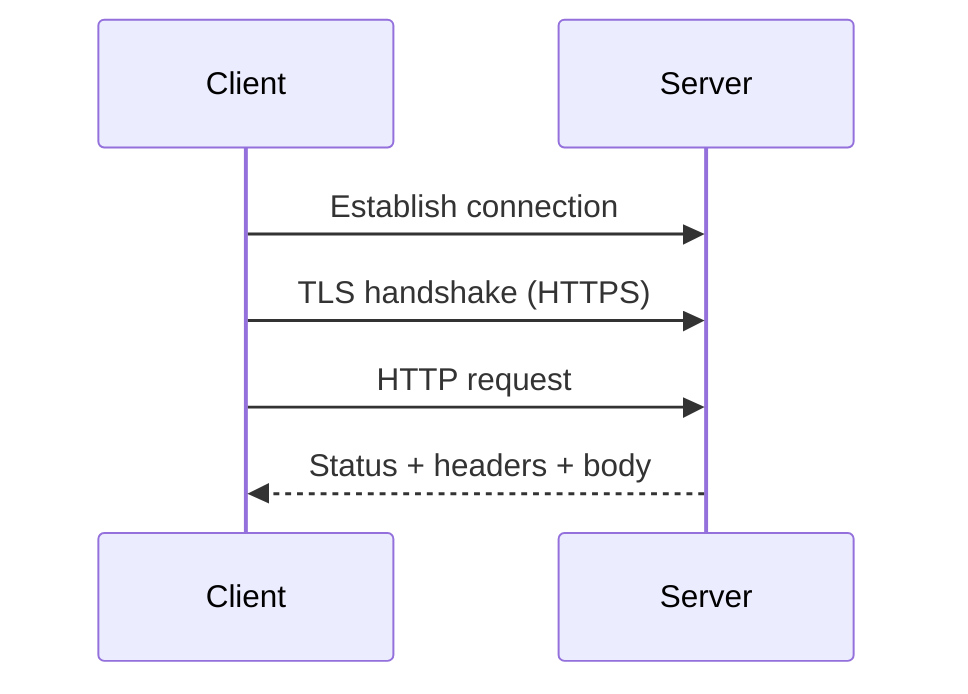

# HTTP and HTTPS

## Introduction
HTTP is a protocol used by clients and servers to exchange web requests and responses. HTTPS protects HTTP communication using TLS.

## Definition
HTTP defines request/response semantics. HTTPS is HTTP carried over a TLS-protected connection, providing encryption in transit and server authentication when certificate validation succeeds.

## How It Works
A client resolves a hostname, establishes a transport connection, negotiates TLS for HTTPS, sends an HTTP request, and receives a status code, headers, and possibly a body. The server may call other services before responding.

## Important Components
- **Method:** Examples include GET, POST, PUT, PATCH, and DELETE.
- **Status code:** Indicates the broad result of a request.
- **Headers:** Metadata associated with requests and responses.
- **TLS certificate:** Supports server identity verification.
- **Reverse proxy:** Receives requests and forwards them to backend services.

## Real-World Example
A load balancer may terminate HTTPS and forward requests to web servers using a separately secured or private connection, depending on the architecture.

## Why DevOps Engineers Need This
HTTP and HTTPS are essential for web servers, APIs, health checks, reverse proxies, TLS certificates, and application troubleshooting.

## Diagram


## Linux Commands and Examples
### `curl -I https://example.com`
Request response headers.

```bash
curl -I https://example.com
```

### `curl -v https://example.com`
Show connection and TLS details; review output before sharing.

```bash
curl -v https://example.com
```

### `getent hosts example.com`
Check hostname resolution.

```bash
getent hosts example.com
```

Some commands may not be installed in a minimal environment. Output and available options vary by distribution and machine.

## Troubleshooting Scenarios
Use the status code, response headers, DNS result, TLS error, and server logs to narrow the issue. A 200 response from one URL does not prove that all backend dependencies are healthy.

## Hands-On Lab
Run `curl -I https://example.com`. Record the response status and two headers. If using verbose output, do not publish cookies, tokens, or private details.

## Interview Questions and Answers
### 1. What is HTTP?
A protocol for exchanging web requests and responses.

### 2. What does HTTPS add?
TLS protection for HTTP communication.

### 3. What does a 404 commonly mean?
The requested resource was not found at that endpoint.

### 4. What does a 5xx status generally indicate?
A server-side error, though the exact cause depends on the status code and system.

### 5. Does HTTPS prove an application is bug-free?
No; it protects the connection but does not guarantee application correctness or security.

## Practice Assignment
Write a troubleshooting checklist for a website that returns a 502 or 503 response. Include load balancer, backend health, port, logs, and dependency checks.

## Key Takeaways
- HTTP is a protocol used by clients and servers to exchange web requests and responses. HTTPS protects HTTP communication using TLS.
- Understand the components and how to inspect them safely.
- Gather evidence before making changes.
- Connect this concept to production reliability and security.

## Further Learning
DNS, ports, TLS certificates, reverse proxies, load balancers.
